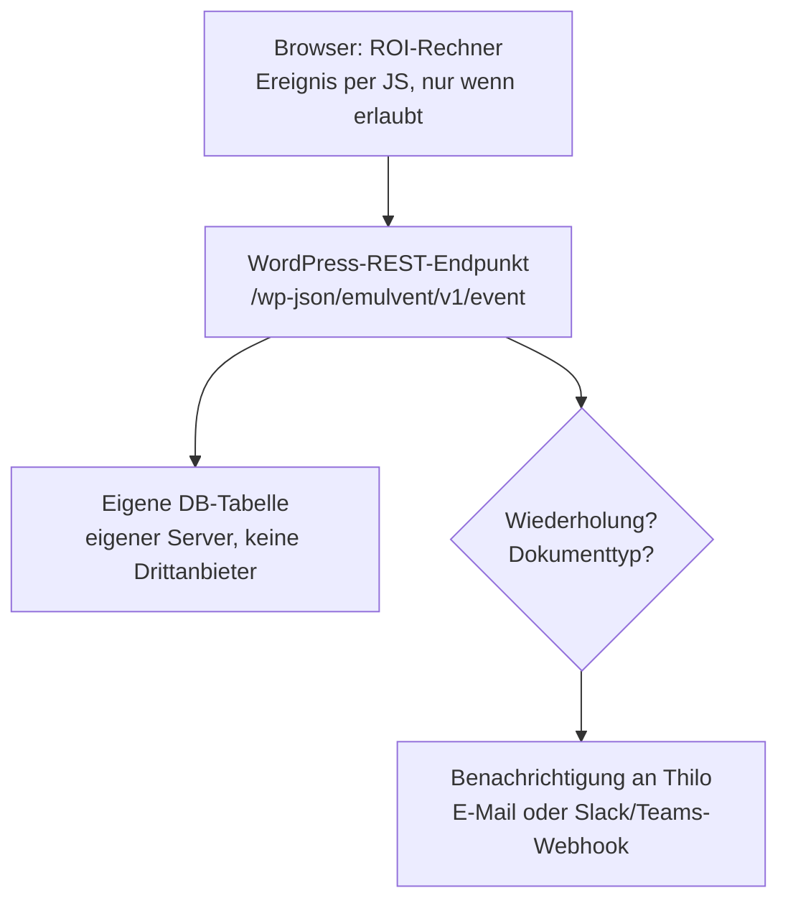

# Konzept: ROI-Kalkulation & Angebot datenschutzkonform tracken

> Der ROI-Rechner läuft vermutlich auf der WordPress-Seite (Plugin `emulvent-machine-data`). Das ist ein Konzept, keine Rechtsberatung. Vor dem Livegang von einem Datenschutzberater prüfen lassen.

## Teil 1: ROI-Kalkulation

### Was erfasst wird

| Ereignis | Bedeutung für den Vertrieb | Nachricht an Thilo |
|---|---|---|
| ROI-Kalkulation durchgeführt | Interesse | Ja |
| Wiederholte Kalkulation von derselben Stelle | Ernsthaftes Interesse | Ja, mit Hinweis „wiederholt“ |
| Dokument „Nachricht an den Chef“ gewählt | Interne Abstimmung beginnt | Ja |
| Dokument „Nachricht an den Betriebsleiter“ gewählt | Fachliche Prüfung | Ja |
| Dokument „Nachricht an Einkauf“ gewählt | Kaufnah, wichtigstes Signal | Ja, hervorgehoben |

### Datenschutz in drei Stufen

Der schwierige Punkt ist „von der gleichen Stelle wiederholt“. Dafür muss man einen Besucher wiedererkennen, und genau dafür braucht es meist eine Einwilligung (§ 25 TDDDG, DSGVO).

**Stufe 1: anonym, ohne Einwilligung**
- Es wird nur gezählt, dass ein Ereignis stattfand: Zeitpunkt, Ereignistyp, Eingabewerte der Kalkulation (Maschinenanzahl, Branche usw.).
- Es gibt keine Cookies, keine vollständige IP-Adresse und kein Fingerprinting.
- Wiederholungen werden nur innerhalb einer Sitzung erkannt, über eine Variable im Arbeitsspeicher, die nach dem Schließen des Tabs verschwindet.
- Rechtsgrundlage: berechtigtes Interesse (Art. 6 Abs. 1 lit. f DSGVO).

**Stufe 2: pseudonym, mit Einwilligung**
- Im Cookie-Banner gibt es die Kategorie „Statistik“. Erst wenn der Besucher zustimmt, wird eine zufällige ID im Browser gespeichert.
- Auf dem Server wird nur ein Hash dieser ID gespeichert, kein Klarname und keine IP.
- So wird sichtbar: „Diese Stelle hat in 10 Tagen 3-mal gerechnet und dann ‚Einkauf‘ gewählt.“

**Stufe 3: identifiziert, freiwillig (empfohlen)**
- Wenn jemand ein Dokument wie „Nachricht an Einkauf“ haben möchte, gibt er Firma und E-Mail ein, und das Dokument wird personalisiert, etwa mit Firmenname und berechneten Zahlen.
- Damit ist „die gleiche Stelle“ sauber erkannt: alle Ereignisse mit derselben Firmen-Domain.
- Die Person gibt ihre Daten bewusst gegen eine Leistung her. Das ist datenschutzrechtlich am saubersten und vertrieblich am wertvollsten.

> ⚠️ Davon rate ich ab: die Firma über ihre IP-Adresse zu ermitteln (Reverse-IP-Dienste wie Leadfeeder). Das ist ohne Einwilligung riskant und häufig ein Abmahngrund.

### Technischer Ablauf im Hintergrund

- **Keine Drittanbieter:** kein Google Analytics und kein Meta-Pixel. Alles bleibt auf dem eigenen Server, also in der EU, und es braucht keine neuen Auftragsverarbeitungsverträge außer mit dem Hoster.
- **Sparsame Nachricht**, zum Beispiel: *„ROI-Kalkulation: 12 Maschinen, Amortisation 14 Monate. Wiederholt (3. Mal). Dokument: Nachricht an Einkauf. Firma: Muster GmbH (nur Stufe 3).“*
- **Option Tageszusammenfassung:** Sonst kommt bei viel Verkehr eine Flut an Mails. Sofort benachrichtigt würde nur bei „Einkauf“ oder einer Wiederholung.
- **Lead-Score:** Kalkulation 1 Punkt, Wiederholung 2, Chef oder Betriebsleiter 3, Einkauf 5. Ab einem Schwellwert kommt eine Nachricht mit „heiß“.

### Begleitende Pflichten (To-do)

- [ ] Datenschutzerklärung um den Abschnitt „ROI-Rechner / Nutzungsauswertung“ ergänzen.
- [ ] Cookie-Banner um die Kategorie „Statistik“ erweitern (für Stufe 2).
- [ ] Bei Stufe 3 einen Hinweis zur Verwendung direkt am Formular, eine Checkbox für Vertriebskontakt und einen Link zur Datenschutzerklärung.
- [ ] Eintrag ins Verzeichnis der Verarbeitungstätigkeiten (Art. 30 DSGVO).
- [ ] Löschfristen festlegen, z. B. anonyme Daten nach 12 Monaten und Lead-Daten ohne Reaktion nach 6 Monaten.
- [ ] Widerspruch und Opt-out ermöglichen.
- [ ] Den Text kurz von einem Datenschutzberater prüfen lassen.

Falls das Ganze in der Schweiz läuft: Das revidierte DSG ist ähnlich, aber beim Tracking etwas lockerer. Stufe 3 funktioniert in beiden Fällen.

## Teil 2: Intelligentes Angebot

**Ziel:** Das Angebot bemerkt selbst, welche Abschnitte den Kunden interessieren, vor allem **Belüftung** und **Sensorik**, und meldet das an Thilo.

### Grundidee: Online-Angebot statt PDF

- Ein PDF lässt sich nicht zuverlässig und sauber auswerten. Tracking-Pixel in PDFs sind technisch unzuverlässig und datenschutzrechtlich heikel.
- Stattdessen bekommt der Kunde einen **persönlichen Link** zum Angebot als Webseite. Ein PDF-Download bleibt zusätzlich möglich.
- Jeder Abschnitt (Belüftung, Sensorik, Preise, Lieferzeit …) ist ein eigener, messbarer Block.

### Was erfasst wird

| Signal | Wie gemessen | Nachricht an Thilo |
|---|---|---|
| Abschnitt Belüftung gelesen | Mindestens 10 Sekunden sichtbar im Bildschirm | In der Tageszusammenfassung |
| Abschnitt Sensorik gelesen | Mindestens 10 Sekunden sichtbar im Bildschirm | In der Tageszusammenfassung |
| Belüftung oder Sensorik **wiederholt** angesehen | Ab dem 3. Aufruf oder an mehreren Tagen | Sofort |
| Angebot weitergeleitet | Neues Gerät oder neuer Zugriff über denselben Link | Sofort (Hinweis: Angebot wird intern geteilt) |
| Button „Frage zu diesem Abschnitt“ geklickt | Ausdrücklicher Klick des Kunden | Sofort, mit Abschnitt und Frage |

**Beispiel-Nachricht:** *„Angebot A-2026-041 (Muster GmbH): Abschnitt Sensorik zum 4. Mal angesehen, insgesamt 3 Min. Belüftung 1-mal. Tipp: Sensorik-Datenblatt nachreichen oder Rückruf anbieten.“*

### Technische Umsetzung

- Persönlicher Link mit zufälligem Token pro Angebot und Empfänger, z. B. `angebot.emulvent.de/a/x7Kq…`
- Jeder Abschnitt hat eine Kennung (`data-section="belueftung"`, `"sensorik"` …). Ein IntersectionObserver misst, wie lange ein Abschnitt sichtbar ist.
- Die Ereignisse gehen an denselben WordPress-REST-Endpunkt wie beim ROI-Rechner. Es braucht keine Cookies, weil das Token im Link den Bezug herstellt.
- Interessenprofil pro Angebot, z. B. „Sensorik 70 %, Belüftung 20 %, Preise 10 %“. Thilo sieht sofort, wo er im Nachfassgespräch ansetzt.
- Bei auffälligem Interesse an einem Thema kann das Angebot passende Inhalte anbieten: Datenblatt, Referenz von Meitlinger-ähnlichen Projekten, Rückruf-Button.

### Datenschutz

Anders als beim ROI-Rechner ist der Empfänger hier bekannt. Das Angebot geht an eine konkrete Person. Die Auswertung des Leseverhaltens ist deshalb klar personenbezogen und muss **offen** geschehen.

- **Rechtsgrundlage:** Vertragsanbahnung beziehungsweise berechtigtes Interesse (Art. 6 Abs. 1 lit. b/f DSGVO), aber nur mit klarer Information. Für das Messen per JavaScript im Browser (§ 25 TDDDG) ist eine kurze Zustimmung beim Öffnen am sichersten.
- **Transparenz im Angebot:** oben ein kurzer Hinweis, z. B.: *„Dieses Angebot ist interaktiv. Wir sehen, welche Abschnitte Sie lesen, um Ihre Fragen gezielt zu beantworten. [Einverstanden] [Ohne Auswertung lesen]“*
- **Ohne Auswertung lesen** muss voll funktionieren. Dann wird nichts gemessen.
- **Datensparsamkeit:** nur Abschnitt, Dauer und Zeitpunkt. Keine Mausbewegungen, keine Session-Replays, keine IP-Speicherung.
- **Löschfrist:** Lesedaten werden mit Abschluss oder Absage des Angebots gelöscht, spätestens nach 6 Monaten.
- **Eintrag** im Verzeichnis der Verarbeitungstätigkeiten und ein Abschnitt in der Datenschutzerklärung.

> 💡 Das stärkste und sauberste Signal ist der Button „Frage zu diesem Abschnitt“. Der Kunde meldet sein Interesse selbst. Das ist datenschutzrechtlich unproblematisch und für Thilo am aussagekräftigsten.

### To-dos Angebot

- [ ] Angebotsvorlage als Webseite mit festen Abschnitten (Belüftung, Sensorik, Preise, Lieferzeit) aufbauen.
- [ ] Persönliche Links mit Token pro Angebot erzeugen.
- [ ] Abschnitts-Messung per IntersectionObserver und Anbindung an den Event-Endpunkt.
- [ ] Regeln für Sofort-Meldung und Tageszusammenfassung festlegen.
- [ ] Hinweis- und Zustimmungstext im Angebot formulieren.
- [ ] Button „Frage zu diesem Abschnitt“ mit Weiterleitung an Thilo.
- [ ] Datenschutzerklärung und Verarbeitungsverzeichnis ergänzen.
